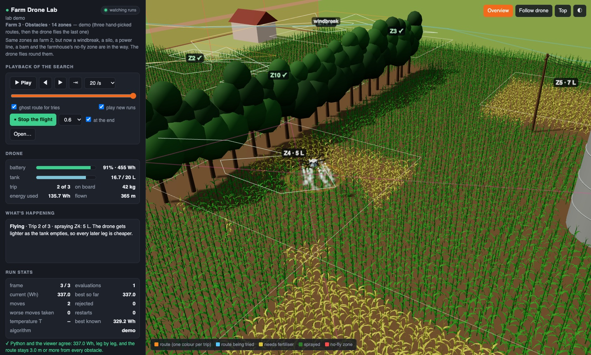
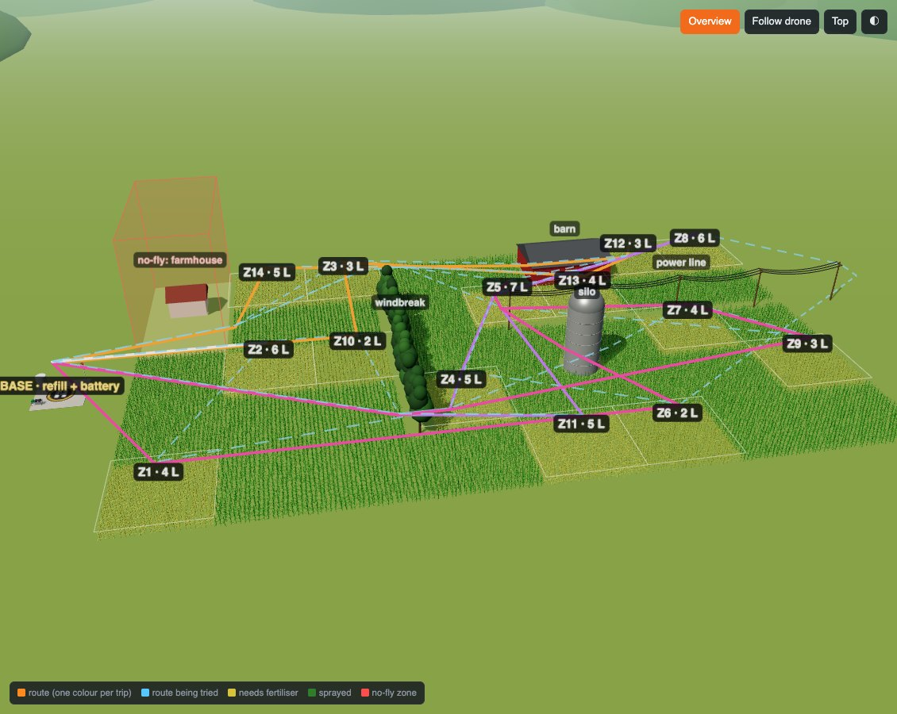
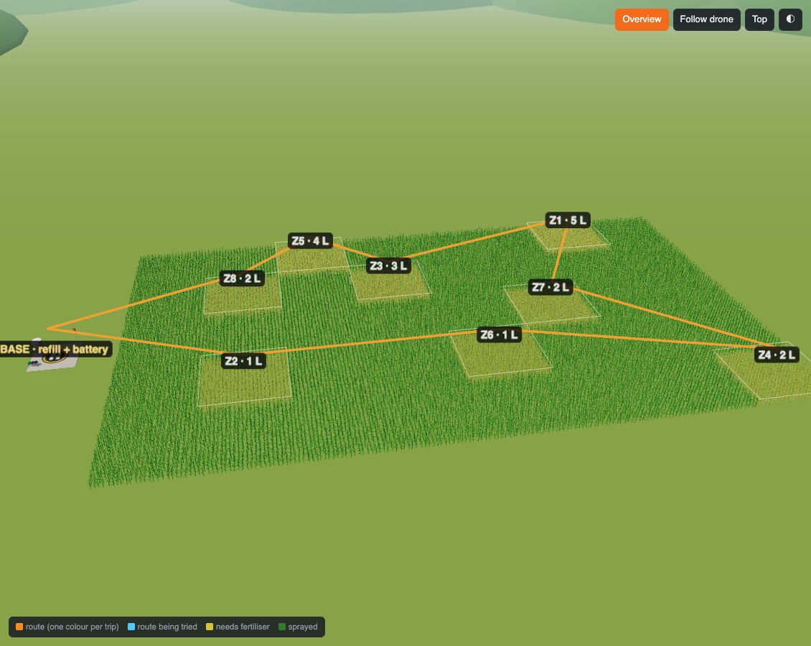
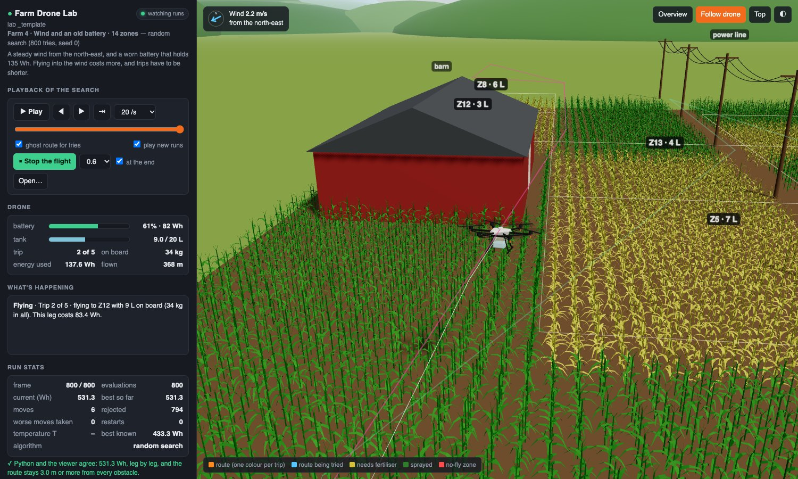

# DSU CSCI 558 · Farm Drone Lab

*Hands-on labs for **CSCI 558 Nature Inspired Computing** at Delaware State University (DSU).*

**Plan a crop-spraying drone's route across a farm, and watch how different search strategies find cheap routes, get stuck, or escape.**



You write the search algorithm in Python. A 3D viewer in your browser replays every route it tried, then flies the best one: the drone takes off, sprays each zone, and comes back to refill, with its battery and tank draining as it goes.

## What you'll see

| | |
|---|---|
|  |  |
| **Watching a search.** The coloured lines are the route the search has now, one colour per trip back to base. The blue dashes are the route it's trying next. Zones still short of fertiliser are pale yellow. | **Trips from above.** A 20 L tank can't do all 14 zones, so the route splits into trips. The drone flies round the windbreak, the silo, the power line, the barn and the farmhouse's no-fly zone. |
|  |  |
| **Farm 1, from lab 00.** Eight zones, one tank. This is the cheapest of all 40,320 orders, found by brute force. | **Follow the drone.** Battery and tank gauges drain leg by leg, and the panel explains what each leg costs. On farm 4 a wind from the north-east makes some directions more expensive. |

---

## What is this, in plain terms?

A spraying drone, like the one on campus, carries a tank of liquid fertiliser. A soil test says which parts of a field are short of nutrients, and how much each one needs. The drone has to visit every one of those **zones**, spray it, and come home.

Two things make it hard:
- **Fertiliser is heavy.** A full 20 L tank weighs 20 kg, almost as much as the drone. Carrying weight costs battery, so it matters *which zones you spray first*. Spraying a zone that needs a lot early on makes every later flight cheaper.
- **The tank and battery are limited.** On a big field the drone has to fly back to base to refill and swap batteries, so the route breaks into **trips**. Later farms add obstacles to fly round (trees, a silo, power lines, a no-fly zone round the farmhouse) and a wind that makes some directions cost more than others.

**Why not just calculate the answer?** There's no formula. **Why not try every possibility?** With 8 zones there are 40,320 orders, and a laptop checks them all in under a second. With 14 zones there are **87 billion**, which would take weeks. Real farms have more.

So instead we **search**: make a guess, score it, and use the score to make a better guess. That's the subject of this project and of Chapter 3 of our textbook.

## The big idea: a landscape you can't see

Give every possible route a **score**: the energy it uses, in watt-hours (Wh). Lower is better.

Now picture all those scores as a landscape. Every route is a spot on the map, and its score is the height of the ground there. Finding the best route means finding the **lowest point** on the map.

The catch is that you're standing on it **in thick fog.** You can only feel the ground right around your feet: you can try routes that are a small change from yours, like swapping two zones, but you can't see the whole map. Every search algorithm is a strategy for walking in that fog:

- **Hill-climbing:** always take whichever small change helps most. It's fast and simple, but when no small change helps, you stop, even if a much better route exists elsewhere. That dip is a **local optimum**. The true lowest point is the **global optimum**.
- **Restarts:** walk downhill from several random routes and keep the best result.
- **Stochastic hill-climbing and simulated annealing:** *sometimes* accept a **worse** route on purpose, so you can climb out of a small dip and find a deeper one.
- **Genetic algorithm:** keep a whole population of routes, let the cheapest ones "breed", and combine their good parts.
- **Ant colony:** many simple agents build routes and leave a trail on good connections for the others to follow. This is the method that was invented for routing problems like this one.

---

## How this ties to Chapter 3

Our textbook is *Fundamentals of Natural Computing* by Leandro de Castro. Chapter 3, "Evolutionary Computing", treats problem solving as a **search**, then builds up from the simplest search method to ones inspired by evolution. This project follows the same path. The book uses a curvy one-variable function, g(x), and the travelling salesman problem; here the same algorithms plan a drone's spraying route.

| Chapter 3 | What the book says | Where you'll see it here |
|---|---|---|
| **3.2 Problem solving as a search task** (p. 62) | Every search needs a *representation*, an *objective*, and an *evaluation function*. | **Representation:** the order to spray the zones in. **Objective:** spray every zone. **Evaluation:** the energy used, from `farmlab`. Lab 00 has you write all three. |
| **3.3.1 Hill climbing**, Algorithms 3.1–3.2 (pp. 65–67) | Move to a better neighbouring point until none is better; restart from random points. | Lab 01. A "neighbour" is a route with two zones swapped, or a section reversed, and *which* you choose changes where it gets stuck. |
| **Stochastic hill climbing and simulated annealing**, Algorithms 3.3–3.5 (pp. 68–71) | Accept a *worse* point with some probability controlled by a temperature T, and cool T slowly. | Lab 01. The viewer counts **worse moves taken** and explains each one. |
| **3.4–3.5 Evolution and genetic algorithms** (pp. 73–99) | A population of candidates improved by selection, crossover and mutation. | Lab 02. A route can't be crossed over like a bit string without visiting some zones twice, so the encoding decides the operators. |
| **3.5.4 Comparing hill climbing, annealing and GAs** (p. 99) | The random methods can escape local optima "due to their stochastic nature". The book compares them to kangaroos looking for Mount Everest. | Every lab compares methods fairly: same farms, same seeds, same number of evaluations. |

(The book climbs *up* to the highest point; we go *down* to the lowest energy. It's the same idea upside down.)

---

## What you'll discover

Some lessons the labs are built around. Lab 00 shows the first two for itself:

1. **Weight changes everything.** On farm 1 the shortest loop round the zones costs 166.6 Wh. **Fly the same loop the other way round** and it costs 143.4 Wh, 14% less, over exactly the same 443 m. That's the best route there is.
2. **Rules of thumb aren't enough.** "Always go to the nearest zone" is 16% worse than the best on farm 1. "Spray the heaviest zones first" is 66% worse. Random guessing with 2,000 tries never gets within 1% of the best.
3. **There's no best algorithm, only a best algorithm for a given landscape.** Obstacles, wind and a worn battery reshape the landscape, and the ranking of the methods changes with it.

---

## How this relates to industry

**What's realistic here:**
- **Spray drones are real farm equipment.** Commercial models carry tanks of tens of litres. Operators really do plan around tank size and battery life, with refills and battery swaps at the field edge.
- **Different parts of a field need different amounts.** Applying fertiliser according to a soil-test map is called *variable-rate application*, a core idea in precision agriculture. Our zones are a simple version of that map.
- **Simulate first, and compare over many runs.** Planning tools are tested in simulation, and one run of a random method proves nothing, in industry as much as in class.
- **This is a vehicle routing problem.** Deciding which stops a vehicle makes, in what order, with limited capacity and refills, is one of the most studied problems in operations research. Genetic algorithms, simulated annealing and ant colony methods are standard tools for it, in delivery logistics as well as on farms.

**What's simplified:** the energy model is a teaching model (see the [guide](docs/GUIDE.md#the-energy-model)). Spraying, take-off and landing cost nothing, and crosswind is ignored. The drone visits each zone's centre rather than sweeping every row. The numbers are round on purpose, so you can check them with a calculator.

---

## Words you'll see

| Word | Meaning |
|---|---|
| **Zone** | A patch of the field that needs fertiliser, e.g. "Z3 · 3 L". |
| **Route** | The order to spray the zones in, e.g. `[2, 0, 3, 1]`. One point on the landscape. |
| **Trip** | One flight from the base and back. A route is split into trips when the tank or battery runs out. |
| **Score** (evaluation function) | The energy a route uses, in watt-hours (Wh). Lower is better. |
| **Neighbour** | A route that's one small change away, such as two zones swapped. |
| **Local optimum** | A route where every neighbour is worse, but which isn't the best overall: a dip, not the valley floor. |
| **Global optimum** | The best route of all. **Best known** is the best anyone has found when nobody can check them all. |
| **Temperature (T)** | In stochastic methods, how willing the search is to accept a worse route. High T means adventurous; low T means cautious. |
| **Seed** | The starting number for the random-number generator. The same seed gives the same "random" run, so results can be repeated and compared. |
| **Trace** | A saved recording of one search run, which the viewer replays. |

---

## Try it

You need **Python 3.8 or newer** (nothing to install) and a web browser with internet access.

```bash
git clone https://github.com/code-rhino/dsu-csci558-nature-inspired-computing-labs.git
cd dsu-csci558-nature-inspired-computing-labs
python3 -m viewer          # window 1: opens the 3D viewer in your browser. Leave it running.
python3 -m viewer.demo     # window 2: three routes, then the drone flies one. If you see that, it works.
```

Then pick a lab:

| Lab | What it is | You write |
|---|---|---|
| **[00 · Start here](labs/00-start-here/README.md)** | Type along: every line of code is in the README. In about 45 minutes you work out what a flight costs, score whole routes, watch the drone fly them, write a random search and measure it honestly. Bonus: rules of thumb vs. the answer key. | `my_first_search.py`, by following the page |

**Coming next**, in the same order as the course: hill-climbing and simulated annealing, genetic algorithms, evolution strategies, particle swarms, ant colonies for routes and safe paths, a neural network that learns the energy model, and a fuzzy controller. Each comes with its textbook reading; see the **[roadmap](docs/ROADMAP.md)**.

**Every lab starts with a "Read first" table** listing the textbook sections and pages to review before you begin.

**About answers:** the labs give you starting code, tests and hints, not solutions. If your class uses these exercises for credit, follow its rules on collaboration and AI help, and don't post your finished files publicly.

**For the technical details** (how the code is organised, the energy model, the farms, every viewer feature, how to add your own lab, and troubleshooting), see the **[project guide](docs/GUIDE.md)**.

The earlier robot-arm version of these labs is kept at the git tag `robot-arm-v1`.

---

MIT licensed: see [LICENSE](LICENSE). Textbook references are to de Castro, *Fundamentals of Natural Computing* (2006), and Eberhart & Shi, *Computational Intelligence: Concepts to Implementations* (2007); page numbers only, no book content is included beyond short quotes.
