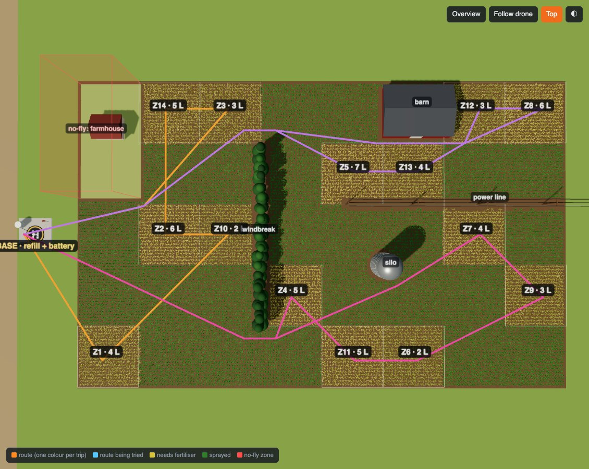

# Project guide

The technical side: how the code is organised, the drone's energy model, the standard farms, what the viewer can do, how to add a lab, and fixes for common problems. For what the project *is*, see the [main README](../README.md).

## How it's organised

```
farmlab/                 the shared farm and drone: no lab logic, no 3D code
  drone.json             mass, tank, battery, energy per kg per metre (single source of truth)
  world.py               Zone, Obstacle, Farm; path(): the shortest way round obstacles
  flight.py              the energy model: plan_trips(), fly(), route_score()
  farms.py               the standard farms 1-4 and their best-known energies

viewer/                  everything 3D: no lab logic
  __main__.py, serve.py  python3 -m viewer: a tiny local web server
  index.html             the three.js viewer: field, crop, obstacles, the drone, routes, gauges
  trace.py               Trace: how Python sends a run to the viewer
  demo.py                python3 -m viewer.demo
  show.py                python3 -m viewer.show <trace or folder>: replay saved runs
  TRACE_FORMAT.md        the JSON a trace contains

labs/
  00-start-here/         type-along starter: the README holds all the code; finished/ has the answers
  _template/             copy this to start a new lab

tests/test_platform.py   checks for farmlab/ and viewer/trace.py
traces/                  saved runs, one folder per lab (ignored by git)
```

A lab never imports three.js and the viewer never imports a lab. They only meet in a trace file:

```
labs/<lab>/your_code.py ──► viewer.trace.Trace ──► traces/latest.json ──► viewer/index.html
            │                                                                   │
            └──────────── farmlab/ (energy, trips, detours) ◄── the viewer re-checks Python's numbers
```

**The viewer checks the Python side.** For the route the drone flies, it recomputes every leg's energy from the drone's numbers and the path, and checks each path keeps its clearance from every obstacle. It shows `✓ Python and the viewer agree: 329.2 Wh, leg by leg…`, or a red warning if they ever disagree.

## The problem

- **The field** is 160 m east by 100 m north, cut into 20 m × 20 m cells. A soil test says which cells (**zones**) need fertiliser, and how many litres.
- **The base station** is just off the west edge at (−15, 50). The drone takes off there, and comes back to refill and swap batteries.
- **A route** is the order to spray the zones in: a permutation such as `[2, 0, 3, 1]`. Labs search over routes. Everything else is worked out for them by `farmlab`.
- **Coordinates:** metres on the ground, x east, y north. In three.js that's x → x, y → −z, height → y.

## The energy model

All numbers are in `farmlab/drone.json`. They're **illustrative**, picked so a leg can be checked with a calculator.

| | |
|---|---|
| Drone, empty tank, with battery | 25 kg |
| Tank | 20 L (1 L of fertiliser = 1 kg) |
| Energy | **0.01 Wh per kg per metre**: 40 kg for 100 m costs 40 Wh |
| Battery | 500 Wh (farm 4: a worn 135 Wh battery) |
| Cruise | 6 m/s at 8 m; sprays from 4.5 m at 0.15 L/s (for the animation) |
| Clearance | 3 m from every obstacle |

`fly(route, farm)` does this:
1. **Splits the route into trips** (`plan_trips`). Zones are taken in route order. A zone starts a new trip when it wouldn't fit in the tank, or when the battery couldn't fly the trip with it and still get home. Every route is therefore a valid plan; the order decides how good it is.
2. **Loads exactly what the trip needs**, flies base → each zone → base, and gets lighter at each zone.
3. **Each leg** costs 0.01 × (mass on board) × (metres flown). Legs go round obstacles by the shortest path (a visibility graph over the obstacles' corners, grown by the clearance).
4. **Wind:** the drone uses the same power per second whatever the wind does, so each metre costs `cruise / (cruise + wind along the path)`. A headwind costs more, a tailwind less.

`route_score(route, farm)` gives the same number as `fly(...).score`, only faster. Use it inside searches.

**What it leaves out**, so students can be told: spraying, take-off and landing cost nothing; real hover power grows faster than mass (roughly mass^1.5); and crosswind is ignored. Any of these makes a good stretch exercise.

## The farms

| Farm | What's new | Orders | Best known |
|---|---|---|---|
| 1 · One tank | 8 zones, 20 L: a single trip | 40,320 | **143.4 Wh** (exact, by brute force) |
| 2 · Refill runs | 14 zones, 59 L: three or more trips | 87 billion | 309.8 Wh |
| 3 · Obstacles | farm 2 + windbreak, silo, power line, barn, farmhouse no-fly zone | 87 billion | 329.2 Wh |
| 4 · Wind and an old battery | farm 3 + wind from the north-east + a 135 Wh battery | 87 billion | 433.3 Wh |

Farms 2–4's best-known values come from many long runs of strong local search and annealing. A student who beats one has found something real.

## The viewer



- **Playback:** play, step and scrub through a search. The coloured route (one colour per trip) is where the search *is*. The blue dashed route is the one being *tried*.
- **Fly the best route:** the drone takes off, flies each trip at cruise height, drops to spray each zone in back-and-forth passes, and lands to refill. The **battery** and **tank** gauges come from Python's leg-by-leg numbers. Corn in each zone starts pale yellow, short of nitrogen, and turns green as it's sprayed. Speed ×4 to ×60.
- **Cameras:** Overview, Follow drone (chase camera), and Top (north up).
- **Run stats:** evaluations, moves, rejections, **worse moves taken**, restarts, temperature or diversity, and the farm's best-known energy, plus a chart of the energy over the run.
- **Wind:** a compass in the corner and a windsock at the base.
- **New runs:** the viewer picks up each run you save automatically. To replay an older one, use `python3 -m viewer.show <file>`, **Open…**, or drag and drop.
- **Keys:** space plays and pauses; ← and → step one frame; F flies the best route.

## Adding a lab

1. Copy the template: `cp -r labs/_template labs/01-your-topic`. It already runs: `python3 labs/01-your-topic/run.py --farm 3`.
2. Use a standard farm (`get_farm(n)`), or define your own `Farm` in your lab folder.
3. Replace the random search in `run.py` with your algorithm. Split it into a stub file and tests if students will fill it in.
4. Record with `Trace(farm, "algorithm name", lab="01-your-topic")`:
   - `rec.tried(route, score, accepted)` for each route scored;
   - `rec.restart(route, score)` when a new run starts;
   - `rec.generation(routes, scores, diversity)` for a population;
   - `rec.save()` at the end. The drone flies the best route it saw.
5. Write the lab's README and add a row to the Labs table in the [main README](../README.md).

If a new lab needs something the viewer can't show yet (for example, moving the base station for a placement problem), add it to `viewer/` and document it in `viewer/TRACE_FORMAT.md`. Lab code should still go through `Trace`.

## The robot-arm version

The first version of these labs moved a six-motor robot arm. It's kept at the git tag **`robot-arm-v1`** and on the **`robot-arm`** branch, complete and runnable (`git switch robot-arm`), for use as a later lab.

## Troubleshooting

| Problem | Fix |
|---|---|
| `Port 8765 is busy` | The viewer is already running in another terminal. Use that one, or `python3 -m viewer 8766`. |
| The page is blank or grey | three.js loads from cdn.jsdelivr.net, so you need an internet connection. |
| "Opened as a file" message | You opened `index.html` directly. Start it with `python3 -m viewer` instead, or drag a trace onto the page. |
| A run doesn't appear | Check `traces/latest.json` was updated (`run.py` prints `saved …`), and that the **play new runs** box is ticked. |
| "old trace format: re-run" | That trace came from the robot-arm version. Run your code again to make a new one. |
